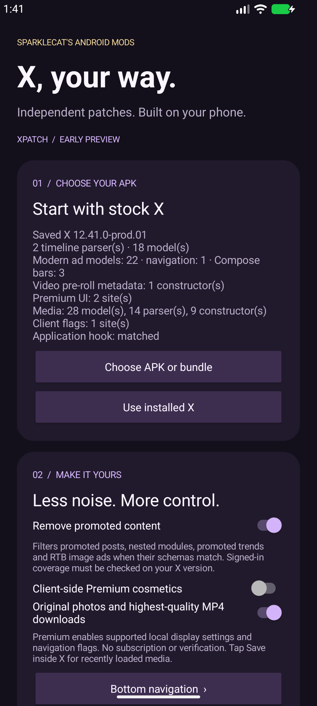
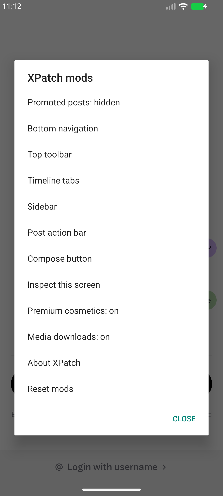

<p align="center">
  
</p>
<h1 align="center">sparklecat’s XPatch</h1>
<p align="center"><strong>Independent X patches. Built on your phone.</strong></p>
<p align="center">
  <a href="https://github.com/sparklecatdev/xpatch/actions/workflows/android.yml"></a>
  <a href="https://github.com/sparklecatdev/xpatch/releases"></a>
  <a href="LICENSE"></a>
</p>
<p align="center">
  <a href="https://github.com/sparklecatdev/xpatch/releases">Download</a> ·
  <a href="https://github.com/sparklecatdev/xpatch/issues/new/choose">Report compatibility</a> ·
  <a href="fordevs.md">Developer guide</a>
</p>

A native Android app that patches your own X / Twitter APK on-device. It has its own bytecode matchers, injected mod runtime and APK signer. It does not depend on ReVanced, Morphe or Piko patch releases.

**Early preview.** The engine matches X `12.41.0-prod.01`, including its new Kotlin serialization path. Signed-in timeline behavior still needs verification. Native view controls work in the test fixture; Compose-only bars are not supported yet. See the compatibility table below before installing.

> Unofficial project. Not affiliated with X Corp., ReVanced, Morphe or Piko. X APKs are not included.

## Features

- **Promoted timeline filtering** — matches serialized `entryId` and `promotedMetadata` fields instead of hardcoded obfuscated names. Supports the older mapper path and the newer Kotlin collection decoder.
- **Original-size media downloads** — tap **Save** inside X. Photos request `name=orig` while preserving JPEG, PNG or WebP; videos use the highest-bitrate MP4 exposed in the decoded media variants.
- **Client-side Premium cosmetics** — enables local Premium display settings and the older custom-navigation switches when those hooks exist. Toggle it from the patcher or the live menu, then restart X.
- **Native bar controls** — hide, scale and recolor matching bottom navigation, toolbar, timeline tabs, sidebar, post actions and compose views. Reorder named children of a `LinearLayout`.
- **Live mod menu** — tap **XP** inside patched X to change settings, inspect resource names and hide individual native views. Changes persist across restarts.
- **APK and split support** — import APK, XAPK, APKM or a device-compatible APKS set, or read your installed stock X. Every part must have a valid signature, matching version and matching signer.
- **Saved profiles and folder watch** — check a folder about every 15 minutes and rebuild new inputs with your settings. Android controls scheduling; installation requires your confirmation.
- **Offline and root-free** — patching stays on your device. No account login, analytics or network permission in the patcher.

Premium cosmetics do not change your subscription, verification or server-side entitlements. The current X build exposes Premium display settings; its older custom-navigation switches are absent.

<p align="center">
  
  
</p>

## Install

1. Download **xpatch.apk** from [Releases](https://github.com/sparklecatdev/xpatch/releases) and install it on Android 8 or newer.
2. Select an unmodified X APK or complete split bundle, or choose **Use installed X**.
3. Review the detected version and hooks. Choose your mods and tap **Build patched APK**.
4. Tap **Install patched X**. Allow XPatch to install apps if Android asks, return to XPatch and tap the button again.
5. Open X and tap **XP** for live controls. Use the inspector to find resource names when a native bar has changed.
6. Open a post, tap **Save**, choose a photo or video and confirm **Download**. On Android 10+, files go to `Downloads/XPatch`; Android 8–9 uses X’s app-specific Download folder.

Stock X and patched X have different signatures. Android may require uninstalling stock X first; that removes local app data, including sessions and unsynced drafts. XPatch never uninstalls it automatically. Keep a complete split bundle for your device; a split base APK alone is insufficient.

Keep XPatch installed and preserve its app data. The signing key for your patched X builds lives in Android Keystore. Clearing XPatch’s data or uninstalling it loses that key, so later builds cannot update an existing patched installation without uninstalling it. Live settings inside X and the patcher’s saved build profile are separate.

The media picker holds up to 120 recently decoded media URLs in memory. Prefetched posts can appear, so check the preview URL before downloading. **Clear list** empties it. Video quality is the best MP4 variant X supplies, which may differ from the uploaded original; live streams and HLS-only media are not supported. Downloads use Android Download Manager.

## Compatibility

| Check | Status |
| --- | --- |
| X `12.41.0-prod.01` / version code `312410001` | Structural match: 1 collection parser, 16 entry models, 3 promoted metadata fields, 24 media models / 14 parsers, 2 Premium display sites |
| X `12.41.0-prod.01`, four installed APK parts | On-device rebuild, Android installer, launch to login and live mod menu verified on Android 16 emulator |
| Synthetic legacy and modern timelines | Patch, sign, install, ad filtering, Premium display state, original photo / best MP4 selection, live bar hiding and saved settings verified on Android 16 emulator |
| Signed-in X timelines and real media downloads | Not verified; report results with your X version and device |
| Native views with matching resource names | Hide, visual scale, background color; child ordering requires `LinearLayout` |
| Compose-only bars | Unsupported; no native resource name to target |
| Other ad formats / future versions | Not guaranteed; new schemas may require an engine update |

New APKs are analyzed again. Unmatched ad hooks stop the build when ad removal is enabled; disabling that option allows a UI-only build. Structural matching is a compatibility check, not a promise that every future release works. Signature checks detect damaged or inconsistent inputs; they do not certify that a third-party APK is an official X release. Supply your own trusted, unmodified copy.

Android 8 is the minimum for XPatch. The X version you supply may require a newer Android version. Large builds need free storage and memory; keep XPatch open while building.

## Build

JDK 21, Android SDK 36 and Build Tools 36.0.0 are required.

```sh
git clone https://github.com/sparklecatdev/xpatch.git
cd xpatch
./gradlew :app:testDebugUnitTest :runtime:testReleaseUnitTest :app:lintDebug :app:lintRelease :runtime:lintRelease :app:assembleDebug :app:assembleRelease :fixture:assembleDebug
```

Debug APK: `app/build/outputs/apk/debug/app-debug.apk`. Release builds are unsigned until signed with your publisher key; see [fordevs.md](fordevs.md). Debug and published builds use different signing identities.

Run the end-to-end fixture check on a disposable emulator:

```sh
python3 scripts/smoke_android.py --serial emulator-5554
```

The script refuses to replace a non-fixture X installation. It clears XPatch test data. It checks media selection without downloading the synthetic URLs, and does not sign into X or test live timelines.

## Credits

[plural-star-mods](https://github.com/sparklecatdev/plural-star-mods) supplied the ZIP alignment/signing foundation, cat artwork and README layout. The matchers and injected X runtime are maintained here. [Piko](https://github.com/crimera/piko) supplied media traversal / original-image handling and feature-switch names, adapted to discovered fields and current schemas. Its GPLv3 license and required [NOTICE](third_party/piko/NOTICE) are preserved in this repo, XPatch and each patched base APK. ReVanced and Morphe helped establish the feature wishlist; upstream patch bundles are not included.

Licensed under **AGPL-3.0-only**. See [LICENSE](LICENSE) and [THIRD_PARTY_NOTICES.md](THIRD_PARTY_NOTICES.md).
