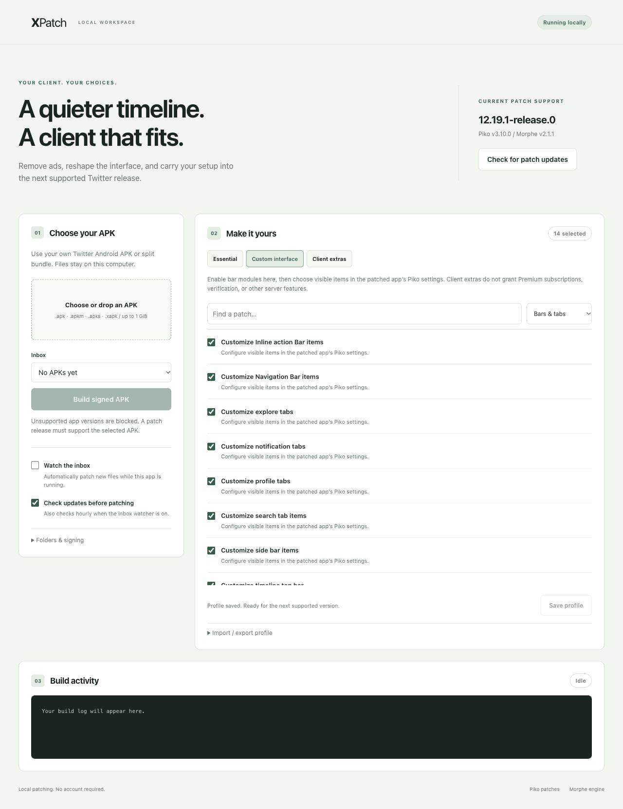

# XPatch

A local patch manager for Twitter on Android. Remove ads, customize navigation and other bars, and reuse your patch profile for later supported releases.



## Run

Requires Python 3.9+ and Java 21+. The app has no Python runtime dependencies.

```sh
git clone https://github.com/sparklecatdev/xpatch.git
cd xpatch
python3 -m xpatch
```

Open `http://127.0.0.1:8765` if your browser does not open automatically.

1. Check for patch updates. XPatch downloads the latest stable [Morphe engine](https://github.com/MorpheApp/morphe-desktop) and [Piko patches](https://github.com/crimera/piko), verifying their GitHub SHA-256 digests.
2. Supply your own Twitter APK, APKM, APKS, or XAPK.
3. Choose patches and save your profile. Build and download the signed APK.
4. Install it on Android. Configure visible bar items in the patched app's Piko settings.

The default **Custom interface** preset includes ad removal, navigation, sidebar, search, explore, timeline, profile, notifications, inline actions, floating action buttons, and navigation badges. **Essential** removes ads, tracking, shortened links, and Premium upsells. **Client extras** adds downloads, undo posts, picture-in-picture, HD video, and dynamic colors where supported.

Client extras do not grant Premium subscriptions, verification, or server-side features.

## New versions

Enable **Watch the inbox** to patch new files placed in the inbox while XPatch runs. Saved profiles carry forward; the watcher checks upstream releases hourly and retries previously unsupported files after the patch catalog changes. It does not download Twitter updates or install APKs automatically.

Compatibility comes from upstream patches. XPatch refuses unsupported versions instead of forcing old bytecode patches onto a new app. At initial validation, Piko 3.10.0 supported Twitter `12.19.1-release.0`. A newer Twitter release needs compatible upstream patches; this app does not generate those patches automatically.

## Data and signing

Data defaults to `~/.local/share/xpatch`. Set `XPATCH_DATA_DIR` or use `--data PATH` before a command to choose another folder.

Keep the `signing` folder backed up. Future patched builds need the same signing key to update an existing patched installation. The stock app has a different signature, so Android may require uninstalling it first, which can remove its local data. Builds, logs, and tool versions are retained locally; original uploads remain in `inbox`.

Only one process can use a data folder at a time. Stop the web app before running CLI commands against the same folder.

```sh
python3 -m xpatch sync
python3 -m xpatch doctor
python3 -m xpatch profile > profile.json
python3 -m xpatch profile --import profile.json
python3 -m xpatch patch /path/to/twitter.apk
python3 -m xpatch watch
python3 -m xpatch --data ./local-data serve --port 8765 --no-browser
```

The service binds to loopback and requires a per-session token for API access. Downloaded engines run locally with your user's permissions. No account credentials are needed.

## Validation

```sh
python3 -m unittest discover -v
node --check xpatch/static/app.js
```

Tests cover manifest parsing, upload validation, profiles, compatibility checks, checksums, job locking, typed engine options, signing-report checks, and output publication. Build tests simulate the engine. The real engine's catalog loading and release downloads have been checked; an actual Twitter APK and Android device are still required for end-to-end patch and feature validation.

## Credits and licensing

This repository is an independent MIT-licensed wrapper. It downloads upstream tools at runtime and does not bundle Twitter, patches, or the engine. [Piko](https://github.com/crimera/piko) and [Morphe](https://github.com/MorpheApp/morphe-desktop) are GPL-3.0 projects; their respective licenses and notices apply to those tools. See upstream repositories for source, notices, and redistribution requirements. XPatch is not affiliated with X, Piko, or Morphe.
